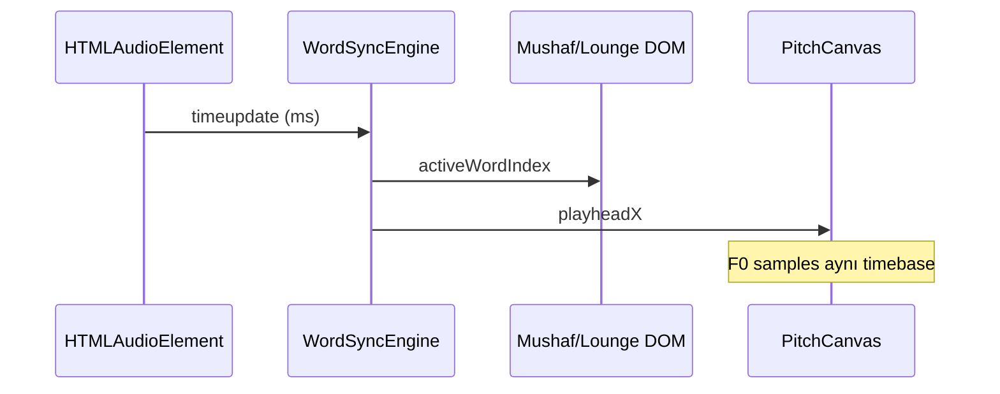

# TİLAVET AKADEMİSİ / CYMATIQUE — TAM PROJE DENETİMİ, GELİŞTİRME VE TAMAMLAMA REHBERİ

> **Doküman Kodu:** `GUIDE-TL-FULL-AUDIT-01`  
> **Sürüm:** 1.0.0  
> **Tarih:** 20 Ekim 2026  
> **Nitelik:** Uygulayıcı AI / geliştirici **prompt + rehber** (tek başına okunabilir)  
> **Denetim kapsamı:** `kimatik_lab/` (canlı uygulama), `src/tilavet/` + `server/` (TypeScript referans yığını), `data/`, `tests/`, `docs/`, `makam_okulu/`, `audio_lab/`  
> **Test durumu (20.10.2026):** `npx vitest run` → **64 geçti / 2 kırık** (`studio_dsp.test.ts` YIN hassasiyeti); `npx tsc --noEmit` → **0 hata**

---

## 0. BU BELGEYİ NASIL KULLANMALISINIZ?

### 0.1. AI ajanına verilecek üst prompt (kopyala-yapıştır)

```text
Sen Tilavet Akademisi / CYMATIQUE projesinde çalışan kıdemli bir ekip üyesisin:
- Kur'an-ı Kerim tilavet, tecvid, kıraat ve makam alanında ilmi doğruluk önceliğin var.
- UI/UX: 10+ yıl deneyim; bilgi hiyerarşisi, okuma odası estetiği, WCAG 2.1 AA.
- Yazılım mimarisi: 7+ yıl; vanilla JS çalışan uygulama ile TS referans kodunun tek gerçek kaynağa indirgenmesi.
- Ses/grafik: 7+ yıl; Web Audio, YIN/DTW, kelime senkronu, Canvas performansı.

Kaynak: docs/TILAVET_PROJE_TAM_GELISTIRME_VE_IYILESTIRME_REHBERI.md

Kurallar:
1) Canlı uygulama kökü kimatik_lab/ — python -m http.server 8000 ile çalışır; 42 Mushaf DOM id'si ve mevcut modül alanları KORUNUR.
2) Placeholder/sahte metrik ve anlamsız rozet metinlerini temizle; yerine ölçülebilir gerçek state koy.
3) İçerik: api.alquran.cloud / EveryAyah / doğrulanmış JSON; elle uydurulmuş ayet metni ekleme.
4) Her değişiklikten sonra: npx vitest run && npx tsc --noEmit.
5) Kapsam: Bölüm 3 öncelik sırasına uy; her PR tek faz odaklı olsun.

Görev: [FAZ-X] — [modül adı] maddelerini uygula; kabul kriterlerini (Bölüm 12) karşıla.
```

### 0.2. Proje ruhu (değiştirilmez ilkeler)

1. **Canlı fem-i muhsin** yerine geçmez; otomatik analiz ve belgeler **tahmini / pedagojik** etiketlidir.  
2. **Tecvid > makam**; kıraat vahyî, makam estetik — karıştırılmaz.  
3. **Ham ses sunucuda saklanmaz** (Zero Raw Audio Retention).  
4. **Obsidyen & Altın** tasarım dili korunur; sadeleştirme = gürültü azaltma, modül silme değil.

---

## 1. YÖNETİCİ ÖZET — DENETİM BULGULARI

| Alan | Durum | Kritik bulgu |
|------|--------|----------------|
| **Çalışan uygulama** | `kimatik_lab/` vanilla JS | Tek gerçek kullanıcı yüzü; ~7.8k satır `tilavet_akademi_engine.js` monolit |
| **Referans yığın** | `src/tilavet/` React + `server/` Express | **Vite/build yok**; tarayıcıda bağlı değil; dokümantasyonla “%100 tamamlandı” algısı üretiyor |
| **Ses laboratuvarı** | İki paralel hat | `tilavet_audio_lab.js` (yükleniyor) vs `audio_lab/` v4 ES modülleri (**index.html'de yok**) |
| **Makam akort** | Kırık yol riski | `index.html` → `makam_okulu/...` ama klasör **proje kökünde**; sunucu `kimatik_lab/` ise **404** |
| **Kelime senkronu** | Eksik / iddia fazlası | README ve PRODUCT_SPEC “kelime senkronu” der; **Dinleme Salonu** yalnızca âyet metni + seek bar |
| **DTW referans** | Pedagojik eğri | `ContourAnalyzer.MODEL_AYAH_CONTOURS` sentetik noktalar; gerçek F0 çıkarımı yalnızca 1 JSON örneği (`fatiha_1_1_husari.json`) |
| **Kullanıcı ilerlemesi** | Sahte varsayılanlar | `defaultState`: `todayMinutes: 8`, `streak: 3`, önceden tamamlanmış dersler |
| **Veri kaynağı** | Üçlü çoğaltma | `tilavet_akademi_data.js` + `kimatik_lab/data/tilavet/` + kök `data/tilavet/` |
| **UI/UX** | Kalabalık HUD + çift navigasyon | Executive bar + drawer + alt nav + rail; Reading Room planı (`UI_UX_RADICAL_TRANSFORMATION_MASTERPLAN.md`) kısmen uygulanmış |
| **Testler** | 2 DSP fail | YIN worklet ile `extractF0FromPCM` (test) uyumsuz (~0.7 Hz, ~8.6 cent sapma) |
| **Dokümantasyon** | Çelişkili | `docs/ROADMAP.md` %100 vs `kimatik_lab/docs/tilavet/ILERLEME.md` Hoca/Sınav **kaldırıldı** notu |

---

## 2. MİMARİ GERÇEKLİK HARİTASI

```
                    ┌─────────────────────────────────────┐
                    │  Kullanıcı (baslat.bat / :8000)      │
                    └─────────────────┬───────────────────┘
                                      │
                    ┌─────────────────▼───────────────────┐
                    │  kimatik_lab/index.html              │
                    │  ├─ tilavet_engine.js   (Mushaf)     │
                    │  ├─ inceleme_engine.js  (Tefsir)     │
                    │  ├─ tilavet_akademi_*   (Akademi)    │
                    │  ├─ tilavet_audio_lab.js (DSP eski)  │
                    │  └─ ui.js               (Kabuk/HUD)  │
                    └─────────────────┬───────────────────┘
                                      │ fetch (opsiyonel)
                    ┌─────────────────▼───────────────────┐
                    │  kimatik_lab/data/tilavet/*.json     │
                    └─────────────────────────────────────┘

  Paralel (derleme yok, UI'da yok):          Paralel (henüz bağlanmadı):
  ┌──────────────────────────┐               ┌──────────────────────────┐
  │ src/tilavet/*.tsx        │               │ kimatik_lab/audio_lab/   │
  │ server/tilavet/*.ts      │               │ (studio_ui, YIN v2, DTW) │
  └──────────────────────────┘               └──────────────────────────┘
```

**Stratejik karar (önerilen):** Üretim tekilleştirmesi **kimatik_lab** üzerinde; `src/tilavet` “altın referans” olarak kalır veya ileride Vite ile aynı veri katmanına bağlanır. İki ayrı “%100 tamamlandı” anlatısı birleştirilmeli.

---

## 3. ÖNCELİK MATRİSİ (UYGULAMA SIRASI)

| Faz | Kod | Odak | Süre tahmini |
|-----|-----|------|----------------|
| **P0** | FAZ-A | Kırık entegrasyonlar (makam script yolu, veri tek kaynak, sahte state) | 1–2 gün |
| **P1** | FAZ-B | Okuma–ses–grafik senkronu (Mushaf + Dinleme + Stüdyo DTW) | 3–5 gün |
| **P2** | FAZ-C | UI/UX sadeleştirme (Reading Room, HUD, navigasyon) | 3–4 gün |
| **P3** | FAZ-D | Ses Lab v4 geçişi + YIN test yeşil | 4–6 gün |
| **P4** | FAZ-E | İçerik ilmi denetim + taslak makam/ ders statüleri | sürekli |
| **P5** | FAZ-F | Dokümantasyon gerçeklik uyumu + isteğe bağlı React birleşimi | 2+ gün |

---

## 4. MODÜL MODÜL DENETİM VE EKSİK LİSTESİ

### 4.1. Mushaf & Tilavet (`tilavet_engine.js`)

**Güçlü yanlar:** 604 sayfa akışı, Uthmani API, EveryAyah, tecvid renkleri, Beni Bul katmanları, sayfa önbelleği, Web Speech + RMS medd/vakıf takibi.

**Eksikler / hatalar:**

| ID | Sorun | Etki | Çözüm yönü |
|----|--------|------|------------|
| M-01 | Kelime zaman damgası yok (oynatıcıda) | Dinleme sırasında kelime vurgusu yapılamaz | Quran.com / quran.com/api veya Foundation kelime segmentleri |
| M-02 | Tecvid renkleri lejant vs kart vs sayfa paleti | UX planı S1 | `--tj-*` tek aile; `ui.js` `data-family` tamamlanmalı |
| M-03 | Simülatör butonları (`btnSimError*`) | Eğitim değeri var; prod’da “laboratuvar” algısı | Gelişmiş moda taşı veya `<details>` ile gizle |
| M-04 | `PRELOADED` sınırlı sayfa | Offline kısmi | Kritik cüzler için genişletilmiş yerel cache stratejisi |
| M-05 | Mushaf ↔ Akademi tecvid köprüsü | `openMushafAndHighlightRule` var; tüm kurallar değil | Eksik kural kartlarını aynı API’ye bağla |

**Senkron hedefi:** Oynatıcı `timeupdate` → aktif kelime indeksi → `.page-ayah-span` / companion panel `.word-correct-highlight` (mevcut sınıf).

---

### 4.2. Âyet İnceleme (`inceleme_engine.js`)

**Güçlü yanlar:** 114 sûre meta, çok âlim tefsir katmanı, konu araması.

**Eksikler:**

| ID | Sorun | Çözüm |
|----|--------|--------|
| I-01 | `Math.random()` ile “öne çıkan anahtar” | Deterministik: sûre no + ayet hash |
| I-02 | Mushaf sekmesi ile ayet konumu senkronu zayıf | `TilavetState` olay bus: `ayah-changed` dinle |
| I-03 | Uzun tefsir blokları mobilde kalabalık | Okuma modu: tipografi token, satır uzunluğu `65ch` |

---

### 4.3. Tilavet Akademisi — alt modüller

#### 4.3.1. Yolculuğum (`yolculuk`)

| ID | Sorun | Kod / davranış |
|----|--------|----------------|
| A-Y01 | Sahte `todayMinutes: 8`, `streak: 3` | `defaultState` sıfır + gerçek oturum sayacı |
| A-Y02 | Ders bitince sabit `+15` dk | Ders `minutes` alanından oku |
| A-Y03 | “Tamamlanan ders” listesi seed | Boş dizi; yalnızca kullanıcı aksiyonu |

**Güncelleme kodu — `kimatik_lab/tilavet_akademi_engine.js`:**

```javascript
const defaultState = {
  currentLevel: 1,
  activeSubView: 'yolculuk',
  selectedMakam: 'rast',
  todayMinutes: 0,
  dailyGoalMinutes: 15,
  streak: 0,
  lastStudyDate: null, // 'YYYY-MM-DD' — streak hesabı için
  userRole: 'student',
  completedLessons: [],
  completedQuizzes: {},
  certificates: [],
  savedRecordings: [],
  cloudConsent: false,
  childMode: false,
  fontSizeScale: 1.0,
  voiceTransferMode: 'p2p',
  voiceConsent24h: false
};

// btnFinishLesson içinde:
const lessonMinutes = lesson.minutes || 10;
state.todayMinutes += lessonMinutes;
const today = new Date().toISOString().slice(0, 10);
if (state.lastStudyDate !== today) {
  const yesterday = new Date(Date.now() - 86400000).toISOString().slice(0, 10);
  state.streak = state.lastStudyDate === yesterday ? (state.streak + 1) : 1;
  state.lastStudyDate = today;
}
```

#### 4.3.2. Elifba / Tecvid / Teknik / Makam / Şan

**Ortak:** İçerik zengin; `tilavet_akademi_data.js` offline güvence iyi.

| ID | Sorun | Çözüm |
|----|--------|--------|
| A-T01 | Harici JSON vs gömülü veri drift | Tek “source of truth” (Bölüm 5) |
| A-M01 | `window.MakamTuning` 404 ihtimali | FAZ-A makam yolu |
| A-M02 | Makam klavyesi ses çakışması | `TilavetAudioManager` zaten var; tüm `new Audio()` kayıt altına |
| A-S01 | Nefes koçu + stüdyo nefes istasyonu çift | UX: Şan sekmesinde “Stüdyo nefesine git” tek CTA |

#### 4.3.3. Dinleme Salonu (`dinleme`)

| ID | Sorun | Detay |
|----|--------|--------|
| A-D01 | **Kelime senkronu yok** | `loungeState.ontimeupdate` yalnızca progress bar |
| A-D02 | Offline fallback metni anlamsız | “Tilâveti dinleyerek…” yerine cache’den Uthmani |
| A-D03 | Besmele 1:1 hardcode | API ile birleştir; tek kod yolu |

**Hedef mimari — kelime senkronu (P1):**

```javascript
// loungeState genişletmesi
loungeState.wordSegments = []; // { startMs, endMs, index, text }
loungeState.activeWordIndex = -1;

async function loadWordSegments(surah, ayah) {
  // 1) Öncelik: yerel segments/{surah}_{ayah}.json (F0 değil, kelime zamanı)
  // 2) API: quran.com veya proxy (server/tilavet) — kelime start/end ms
  // 3) Fallback: eşit bölüştürme (yalnızca son çare, UI'da "tahmini" etiketi)
}

player.ontimeupdate = () => {
  // ... mevcut seek ...
  const tMs = player.currentTime * 1000;
  const idx = loungeState.wordSegments.findIndex(
    w => tMs >= w.startMs && tMs < w.endMs
  );
  if (idx !== loungeState.activeWordIndex) {
    loungeState.activeWordIndex = idx;
    highlightLoungeWords(idx);
  }
};
```

#### 4.3.4. Ses Laboratuvarı / Stüdyo (`studyo`)

| ID | Sorun | Detay |
|----|--------|--------|
| A-ST01 | `audio_lab/` v4 bağlı değil | ES modül stüdyo daha modüler |
| A-ST02 | DTW referans sentetik | Kullanıcıya “model eğrisi” etiketi veya gerçek kontur |
| A-ST03 | YIN: autocorrelation (eski) vs worklet (yeni) | Tek pipeline |
| A-ST04 | HTML typo `#b388ff)` | CSS düzelt |
| A-ST05 | Mikrofon HUD stüdyoyu göstermiyor | `ui.js` `syncMicrophoneHUD` genişlet |

**Gerçek kontur yükleme — `tilavet_audio_lab.js` genişletme:**

```javascript
async loadReferenceFromJson(url) {
  const res = await fetch(url);
  if (!res.ok) return null;
  const json = await res.json();
  this.MODEL_AYAH_CONTOURS[json.ayahKey] = {
    title: json.title,
    makam: json.makam,
    kararHz: json.kararHz,
    durationMs: json.durationMs,
    points: json.points,
    source: 'extracted_f0',
    qariProfiles: json.qariProfiles || {}
  };
  return json.ayahKey;
}

// init: MODEL_AYAHS için
await contourAnalyzer.loadReferenceFromJson(
  'audio_lab/data/qari_contours/fatiha_1_1_husari.json'
);
```

**Kontur üretim CLI (mevcut):**

```bash
node scripts/extract_reference_contour.mjs --input path/to/husari_001001.mp3 --ayah 1:1 --karar 220
```

#### 4.3.5. Kıraat, Asistan, Sözlük, Ayarlar

| Modül | Eksik |
|--------|--------|
| **Kıraat** | `qiraat.json` yalnızca fetch; offline tam `QIRAAT` gömülü doğrula |
| **Asistan** | Kural tabanlı; uzun cevaplarda kaynak satırı (`SOURCES.md` link) |
| **Sözlük** | 40 terim; arama iyi; Arapça `lang="ar"` tüm maddelerde |
| **Ayarlar** | “Verileri sıfırla” `defaultState`’e döner — sahte seed tekrar gelmesin (FAZ-A) |

**Bilinçli kapsam dışı (testlerle sabitlenmiş):** Hoca Paneli ve Sınav & Sertifika **kimatik_lab UI’dan kaldırılmış** (`akademi_views.test.ts`). React tarafında (`TeacherPage`, `ExamPage`) kod duruyor — ya gizli “geliştirici modu” ya da ayrı dağıtım; README’de net yazılmalı.

---

### 4.4. UI/UX kabuk (`index.html`, `style.css`, `ui.js`, `tilavet_akademi.css`)

**Kalabalık kaynakları:**

1. Üst HUD: 7+ kapsül (Mushaf + İnceleme + Mikrofon + Kâri + …)  
2. Akademi executive bar + breadcrumb + 12’li alt nav + drawer ağacı  
3. Emoji yoğunluğu (nav, kart rozetleri)  
4. `UI_UX_RADICAL_TRANSFORMATION_MASTERPLAN.md` Bölüm 5 (S1–S10) — kısmen açık

**Sadeleştirme ilkesi — alanları koruyarak:**

| Teknik | Uygulama |
|--------|----------|
| **Bağlamsal HUD** | `data-active-tab` ile yalnızca ilgili telemetri (`style.css` kısmen var; Akademi seviye rozeti ekle) |
| **Tek birincil nav** | Rail = modül; Drawer = derin link; Akademi alt nav’ı **daraltılmış modda** grupla (Eğitim / Dinleme / Araçlar) |
| **Vurgu ekonomisi** | Altın = Mushaf/marka; cyan = canlı etkileşim; yeşil = başarı (DESIGN_DECISIONS K3) |
| **Metin rozetleri** | “GERÇEK ZAMANLI DSP MOTORU” gibi pazarlama cümlelerini kaldır veya Ayarlar→Hakkında |
| **Tipografi tabanı** | Minimum 12px UI, 16px okuma gövdesi; `fontSizeScale` tüm akademi view’lara CSS variable |

**Mikrofon HUD — stüdyo entegrasyonu (`ui.js`):**

```javascript
function syncMicrophoneHUD() {
  // ... mevcut tilavet dinleme kontrolleri ...
  const studioMicActive = window.TilavetAkademiEngine?.isStudioMicActive?.() === true;
  const isRecording = isLiveBadgeActive || isListeningBtn || isBeniBulVoice || studioMicActive;
  // ...
}
```

(`tilavet_akademi_engine.js` export: `isStudioMicActive: () => isStudioMicActive`)

---

## 5. VERİ BÜTÜNLÜĞÜ — TEK KAYNAK STRATEJİSİ

### 5.1. Mevcut üçlü yapı

| Konum | Rol |
|--------|-----|
| `kimatik_lab/tilavet_akademi_data.js` | `file://` ve offline **birincil** |
| `kimatik_lab/data/tilavet/*.json` | HTTP fetch ile güncelleme |
| `data/tilavet/*.json` (kök) | Sunucu kökü yanlışsa **kullanılmıyor** |
| `src/tilavet/data/**` | TS testleri + gelecek React |

### 5.2. Önerilen pipeline

```text
[src/tilavet/data]  ──build script──►  kimatik_lab/data/tilavet/
                                      └──► tilavet_akademi_data.js (bundle veya import map)
```

**Build script taslağı (`scripts/sync_tilavet_data.mjs`):**

```javascript
import fs from 'fs';
import path from 'path';

const SRC = 'src/tilavet/data';
const DEST = 'kimatik_lab/data/tilavet';

// lessons: tüm L*.json birleştir → lessons.json
// makam: makam/*.json → makamlar.json { makamlar: [...] }
// sozluk, reciters: doğrudan kopya + şema validate (tests/content.test.ts mantığı)
```

**CI kuralı:** `tests/tilavet/akademi_data.test.js` içine kök vs kimatik_lab hash karşılaştırması ekle.

---

## 6. SES, GRAFİK VE SENKRON — TEKNİK DERİNLİK

### 6.1. YIN test kırığı (P3)

- Test: `scripts/extract_reference_contour.mjs` → `extractF0FromPCM`  
- Runtime: `yin_processor.worklet.js` (hop 480 @ 48kHz) + `tilavet_audio_lab.js` autocorrelation  

**Hedef:** Ortak `kimatik_lab/audio_lab/core/yin_core.js` (saf fonksiyon); worklet ve test aynı modülü import eder (Node için küçük wrapper).

**Worklet eşik hizalama (özet):**

```javascript
// yin_processor.worklet.js — test ile aynı
this.threshold = 0.15;
this.minHz = 65;
this.maxHz = 1000;
// RMS gate: 0.015 (extract script ile aynı)
```

### 6.2. AudioContext tekilliği

`AudioFocusManager` + `TilavetAudioManager` birlikte kullan; yeni modül eklerken:

```javascript
await window.TilavetAudioManager?.notifyPlay('studyo_v4');
```

### 6.3. Canvas performans

Stüdyo DTW grafiği: `requestAnimationFrame` tek döngü; sekme gizliyken `switchAkademiSubView` içinde `cancelAnimationFrame` (kısmen var — spectrum + playhead id’leri denetle).

### 6.4. Okuma–grafik senkronu (özet diyagram)



---

## 7. FAZ-A — KIRIK ENTEGRASYONLAR (P0) UYGULAMA PROMPTU

**Görev listesi:**

1. **Makam script yolu** — Seçenek A (önerilen): `makam_okulu/` → `kimatik_lab/makam_okulu/` kopyala veya symlink. Seçenek B: `index.html` yollarını `../makam_okulu/` yap (sunucu kökünü proje root yap).  
2. **defaultState** temizliği (Bölüm 4.3.1 kodu).  
3. **Kök `data/tilavet`** ya silin ya da sync script ile kimatik_lab’a yansıt; README’de tek path.  
4. **README / ROADMAP** düzeltmesi: “18 modül canlı” → “kimatik_lab: 12 akademi alt görünüm + 2 ana sekme; React yığını referans”.  
5. **Stüdyo banner** CSS typo: `color:#b388ff;`

**Kabul:** Tarayıcı ağ sekmesinde `makam_okulu/*.js` 404 yok; yeni kullanıcı Yolculuk’ta 0 dk / 0 streak görür.

---

## 8. FAZ-B — SENKRON (P1) UYGULAMA PROMPTU

1. Kelime segment JSON şeması tanımla (`audio_lab/data/word_segments.schema.json`).  
2. Fâtiha + Bakara 255 için pilot segment (manuel veya API).  
3. Dinleme Salonu `highlightLoungeWords`.  
4. Mushaf oynatıcıda aynı `WordSyncEngine` paylaşımı (`tilavet_engine.js` refactor minimal).  
5. Fallback segmentlerde UI’da `span.tahmini-sync-badge`.

**Kabul:** Pilot ayetlerde kelime vurgusu ±200 ms içinde; fallback etiketli.

---

## 9. FAZ-C — UI/UX (P2) UYGULAMA PROMPTU

`UI_UX_RADICAL_TRANSFORMATION_MASTERPLAN.md` Bölüm 12’yi **kimatik_lab** dosyalarına uyarla:

1. `--tj-*-ui` token birleştirme (`style.css`).  
2. Beni Bul overlay (kısmen var) — Mushaf scroll kilidi.  
3. Mobil oynatıcı dock (`@media max-width: 1180px`).  
4. 77 ölü CSS sınıfı temizliği (plan Bölüm 12.2).  
5. Akademi “pazarlama rozetleri” → sade metin veya kaldır.

**Kabul:** Lighthouse a11y ≥ 90 (lokal); header yüksekliği ≤ 56px masaüstü.

---

## 10. FAZ-D — SES LAB V4 (P3) UYGULAMA PROMPTU

1. `index.html` sonuna modül girişi:

```html
<link rel="stylesheet" href="audio_lab/ui/ses_lab_v4.css?v=20261020">
<script type="module">
  import { StudioUI } from './audio_lab/ui/studio_ui.js';
  window.initSesLabV4 = () => {
    const host = document.getElementById('akademi-view-studyo');
    if (host && !host.dataset.v4Mounted) {
      host.innerHTML = '<div id="sesLabV4Root"></div>';
      const ui = new StudioUI('sesLabV4Root');
      ui.init();
      host.dataset.v4Mounted = '1';
    }
  };
</script>
```

2. `switchAkademiSubView('studyo')` sonunda `window.initSesLabV4?.()` çağır.  
3. Eski `renderStudyoView` içeriğini feature flag: `localStorage.sesLabVersion = 'v4'|'legacy'`.  
4. YIN birleştirme → vitest yeşil.

**Kabul:** 5 istasyon v4’te çalışır; legacy flag ile geri dönüş; 66/66 test.

---

## 11. FAZ-E — İÇERİK VE İLMİ DOĞRULUK (P4)

Referans: `docs/CONTENT_STANDARDS.md`, `docs/SOURCES.md`, `docs/tilavet/icerik-yazim-rehberi.md`.

| Görev | Açıklama |
|--------|----------|
| Makam JSON | `src/tilavet/data/makam/*.json` çoğu `draft` — uzman formu (`ek-b-makam-uzmani-inceleme-formu.md`) |
| Medd süreleri | “1 elif ≈ X ms” tempo moduna göre (`TEMPOLAR_DETAY`) — UI’da tempo seçiliyken güncelle |
| Kıraat matrisi | İmâle/nakil maddeleri kaynaklı; her hücrede `sourceId` |
| Tefsir | İnceleme metinleri kısaltılmaz (kural C8); yalnızca sunum iyileştirilir |
| DTW / makam etiketi | Sentetik eğride “makam” iddiasını yumuşat: “öğretici model seyri” |

**Yasak:** Anlamsız doldurma cümleleri (“sistem varsayılan”, “lorem”, tekrarlayan rozet). Offline fallback **gerçek ayet** veya “çevrimdışı — şu ayet önbellekte yok” mesajı.

---

## 12. KABUL KRİTERLERİ (TAM PROJE)

- [ ] `npx vitest run` → 66/66  
- [ ] `npx tsc --noEmit` → 0 hata  
- [ ] `python -m http.server 8000` (kimatik_lab) — konsol 404 yok (makam, worklet, json)  
- [ ] Yeni kullanıcı: sahte streak/dakika yok  
- [ ] Dinleme Salonu: pilot ayetlerde kelime senkronu veya açık “tahmini” etiketi  
- [ ] DTW: en az 8 model âyet için `source: extracted_f0` veya UI’da sentetik uyarısı  
- [ ] HUD: yalnızca bağlamsal alanlar; Akademi mikrofonu yansır  
- [ ] Dokümantasyon: README, ROADMAP, ILERLEME aynı gerçekliği anlatır  
- [ ] Veri: tek sync pipeline; drift testi CI’da  

---

## 13. REGresyon TEST PLANI (MANUEL)

| Senaryo | Adımlar | Beklenen |
|---------|---------|----------|
| Mushaf oynat | Sayfa 50, ayet seç, play | Ses + ayet paneli senkron |
| Tecvid köprüsü | Akademi → Tecvid → Mushaf’ta Gör | Doğru sayfa + pulse |
| Dinleme | Minşâvî Fâtiha continuous | Ayet metni API’den; progress akar |
| Stüdyo mikrofon | Kayıt + DTW | Sonuç veya “ses algılanamadı” dürüst mesaj |
| Sekme geçişi | Tilavet ↔ Akademi | Ses durur, drone temizlenir |
| Beni Bul | 2:255 ara | Doğru sayfa |
| CVD modu | ui.js toggle | Tecvid renkleri erişilebilir alternatif |
| Reset | Ayarlar → sıfırla | 0 ilerleme, seed yok |

---

## 14. DOSYA HIZLI REFERANS

| Dosya | Satır/boyut | Not |
|--------|-------------|-----|
| `kimatik_lab/tilavet_akademi_engine.js` | ~7888 | Monolit — view başına modül dosyalarına bölün (uzun vadede) |
| `kimatik_lab/tilavet_akademi_data.js` | ~8200+ | Veri bundle |
| `kimatik_lab/tilavet_engine.js` | ~3600+ | Mushaf motor |
| `kimatik_lab/tilavet_audio_lab.js` | ~1000 | DSP + ContourAnalyzer |
| `kimatik_lab/ui.js` | ~550 | Kabuk |
| `tests/tilavet/*.test.ts` | 66 test | kalite kapısı |

---

## 15. SONRAKİ OTURUM İÇİN KISA PROMPT ÖRNEKLERİ

**Otürüm 1 — P0:**  
“`docs/TILAVET_PROJE_TAM_GELISTIRME_VE_IYILESTIRME_REHBERI.md` FAZ-A maddelerini uygula; makam script 404 düzelt, defaultState temizle, README gerçeklik güncellemesi.”

**Otürüm 2 — P1:**  
“Aynı rehber FAZ-B: Fâtiha 1–7 kelime segment + Dinleme Salonu highlight; WordSyncEngine paylaşımı.”

**Otürüm 3 — P3:**  
“FAZ-D: audio_lab v4 mount, YIN core birleştir, studio_dsp.test yeşil.”

---

## 16. REVİZYON GEÇMİŞİ

| Sürüm | Tarih | Not |
|--------|--------|-----|
| 1.0.0 | 20.10.2026 | Tam proje taraması; test/dosya/kod denetimi; fazlı uygulama rehberi |

---

*Bu belge, projenin dini ve pedagojik ruhunu koruyarak teknik borcu görünür kılar ve her faz için doğrudan uygulanabilir prompt + kod parçaları sunar. Uygulama sırasında `docs/DESIGN_DECISIONS.md` ve `docs/PRODUCT_SPEC.md` ile çelişen durumda **canlı kimatik_lab davranışı** esas alınır; spec ardından güncellenir.*
