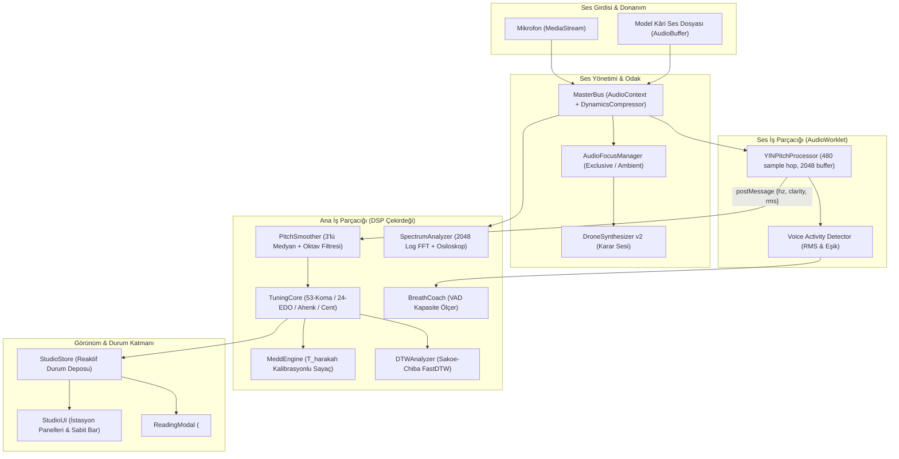

# 2. BÖLÜM 2: HEDEF MİMARİ, MODÜL SÖZLEŞMELERİ VE VERİ AKIŞI

## 2.1. Fiziksel ve Mantıksal Dizin Ağacı
Ses Laboratuvarı v4 mimarisi, hem Vanilla JS (`kimatik_lab/`) çalışma ortamını hem de modern React/TypeScript (`src/`) yapısını tek bir paylaşımlı DSP çekirdeği üzerinden besleyen katmanlı bir topolojiye sahiptir.

```
kimatik_lab/
├── audio_lab/
│   ├── core/
│   │   ├── types.ts                    # Merkezi TypeScript sözleşmeleri
│   │   ├── master_bus.js               # AudioContext, Limiter, Master Gain
│   │   ├── audio_focus_manager.js      # Ses çakışmasını engelleyen odak orkestratörü
│   │   ├── mic_manager.js              # Paylaşımlı mikrofon yöneticisi, iOS emniyeti
│   │   ├── yin_processor.worklet.js    # AudioWorklet 10ms hop YIN F0 dedektörü
│   │   ├── pitch_smoother.js           # Medyan filtresi ve oktav sıçrama önleyici
│   │   ├── tuning_core.js              # 53-koma, 24-EDO, 12-TET, Ahenkler, Karar algılayıcı
│   │   ├── medd_engine.js              # Hece kalibrasyonlu medd ölçüm motoru
│   │   ├── dtw_v2.js                   # Sakoe-Chiba FastDTW kontur ve ritim puanlayıcı
│   │   ├── spectrum_analyzer.js        # 2048 FFT logaritmik rezonans ve sıfır-geçişli osiloskop
│   │   └── breath_coach_v2.js          # VAD destekli otomatik nefes kapasite testörü
│   ├── instruments/
│   │   ├── drone_v2.js                 # Yarışmasız (race-free), ducking destekli karar demi
│   │   └── macro_piano_v2.js           # 53-koma dinamik derece etiketli mûsiki klavyesi
│   ├── ui/
│   │   ├── studio_store.js             # Reaktif durum deposu (Pub/Sub)
│   │   ├── studio_ui.js                # Kısmi DOM render motoru, 5 istasyon paneli
│   │   ├── reading_modal.js            # Tam ekran odaklı <dialog> Okuma Penceresi
│   │   └── ses_lab_v4.css              # Obsidyen & Altın v4 tasarım sistemi
│   └── data/
│       ├── qari_contours/              # Kâri referans F0 kontur JSON dosyaları
│       │   ├── fatiha_1_1_husari.json
│       │   ├── ayetulkursi_2_255_abdulbasit.json
│       │   └── fecr_89_27_minshawi.json
│       └── qari_contour.schema.json    # JSON Şeması
├── scripts/
│   └── extract_reference_contour.mjs   # Ses dosyasından çevrimdışı F0 çıkarma CLI
└── tests/
    ├── studio_dsp.test.ts              # YIN DSP sentetik sinyal doğrulama testleri
    ├── medd_engine.test.ts             # Medd süre ve hangover doğrulama testleri
    └── dtw_scoring.test.ts             # DTW şekil ve ritim skor testleri
```

## 2.2. Veri Akış Şeması (Data Flow Pipeline)



## 2.3. Merkezi Tip Sözleşmeleri (`core/types.ts`)
Tüm sistem bileşenleri arasındaki veri alışverişi aşağıdaki mutlak TypeScript sözleşmelerine tâbidir:

```typescript
// kimatik_lab/audio_lab/core/types.ts
// Merkezi Tip Sözleşmeleri (Single Source of Truth)

export type TuningSystemId = '12-tet' | '53-koma' | '24-edo';

export type AhenkId = 
  | 'boulahank'   // Bolâhenk (Referans A3 = 220.00 Hz)
  | 'davud'       // Dâvud (E3 = 164.81 Hz, -5 ses)
  | 'sah'         // Şah (F3 = 174.61 Hz, -4 ses)
  | 'mansur'      // Mansur (G3 = 196.00 Hz, -2 ses)
  | 'kiz'         // Kız (B3 = 246.94 Hz, +2 ses)
  | 'yildiz'      // Yıldız (C4 = 261.63 Hz, +3 ses)
  | 'mustahsen'   // Müstahsen (C#4 = 277.18 Hz, +4 ses)
  | 'supurde';    // Süpürde (D4 = 293.66 Hz, +5 ses)

export interface PitchFrame {
  timestamp: number;    // Performans milisaniyesi (ms)
  hz: number;           // Ham frekans (Hz, ses yoksa 0)
  clarity: number;      // Perde belirlilik katsayısı [0.0 - 1.0]
  rms: number;          // Kök-ortalama-kare enerji [0.0 - 1.0]
  voiced: boolean;      // İnsan sesi var mı?
}

export interface TunedPitchResult {
  rawHz: number;
  filteredHz: number;
  noteName: string;         // Batı nota adı (örn: "A3", "Bb3")
  traditionalName: string;  // Geleneksel perde adı (örn: "Dügâh", "Segâh")
  centDeviation: number;    // Sapma cent [-50.0 ile +50.0]
  komaDeviation: number;    // Türk sisteminde koma sapması [-4.5 ile +4.5]
  targetHz: number;         // En yakın perdenin ideal frekansı
  tuningSystem: TuningSystemId;
  inTune: boolean;          // Eşik içinde mi? (örn: |cent| <= 15)
}

export interface AhenkDefinition {
  id: AhenkId;
  nameTr: string;
  dugahHz: number;          // Dügâh (A) perdesinin bu ahenkteki frekansı
  semitoneShift: number;    // Bolâhenk'e göre yarım ses kayması
  description: string;
}

export type FocusPriority = 'exclusive' | 'ambient';

export interface FocusRequester {
  id: string;
  name: string;
  priority: FocusPriority;
  onInterrupted: () => void;
  onResumed?: () => void;
}

export type MeddType = 
  | 'tabii'      // 1-2 elif (Medd-i Tabîî)
  | 'muttasil'   // 4-5 elif (Medd-i Muttasıl)
  | 'munfasil'   // 2-4 elif (Medd-i Munfasıl)
  | 'lazim'      // 6 elif (Medd-i Lâzım)
  | 'ariz'       // 2-4-6 elif (Medd-i Ârız)
  | 'lin';       // 2-4-6 elif (Medd-i Lîn)

export type ReadingTempo = 'hadr' | 'tedvir' | 'tertil' | 'tahkik';

export interface MeddCardInfo {
  id: string;
  arabicText: string;
  transcription: string;
  surahAyah: string;
  meddType: MeddType;
  targetElifMin: number;
  targetElifMax: number;
  ruleExplanationTr: string;
  exemplarAudioUrl?: string;
  exemplarHz?: number;
}

export interface MeddMeasurementResult {
  cardId: string;
  measuredDurationMs: number;
  calculatedElif: number;
  harakahUnitMs: number;
  targetMin: number;
  targetMax: number;
  isSuccessful: boolean;
  tempoDetected: ReadingTempo;
  completedAt: number;
}

export interface TimeSeriesPoint {
  t: number;      // Başlangıçtan itibaren geçen süre (saniye)
  hz: number;     // Frekans (Hz)
  cent: number;   // Karar sesine göre cent sapması
  rms: number;    // Ses şiddeti
}

export interface QariReferenceContour {
  id: string;
  titleTr: string;
  surah: number;
  ayah: number;
  qariName: string;
  makamId: string;
  tonicHz: number;
  audioDurationSeconds: number;
  audioUrl: string;
  samples: Array<{ t: number; hz: number; cent: number }>;
}

export interface DTWComparisonResult {
  shapeScore: number;     // 0 - 100 (Seyir ve perde uyumu)
  rhythmScore: number;    // 0 - 100 (Zamanlama ve durak uyumu)
  combinedScore: number;  // Ağırlıklı genel akustik skor
  warpingPath: Array<[number, number]>;
  averageDistance: number;
  legalNotice: string;    // "Fem-i muhsin icazeti değildir" uyarısı
}

export interface SpectrumBands {
  chest: number;      // 80 - 300 Hz (Göğüs Rezonansı)
  oral: number;       // 300 - 1500 Hz (Ağız / Boğaz)
  nasal: number;      // 1500 - 2500 Hz (Hayşûm / Geniz)
  qariFormant: number;// 2500 - 3500 Hz (Kâri Formantı / İrşâd Çınlaması)
  brilliance: number; // 3500 - 8000 Hz (Tiz Aydınlık)
}

export interface BreathSessionResult {
  mode: '4-4-8' | '2-4-12' | 'capacity_test';
  durationSeconds: number;
  stabilityScore: number;
  timestamp: number;
}
```
